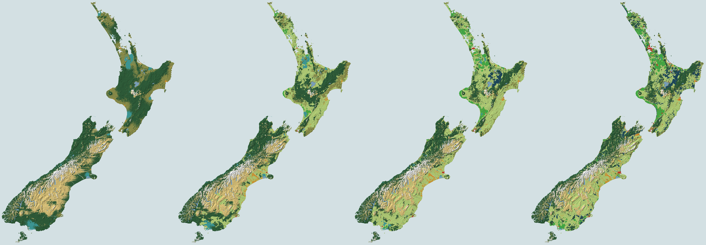

# NZ_land_use

Animated cellular-automaton model of Aotearoa New Zealand land-use change, 1840–2025, on the LINZ-derived DEM and anchored to LCDB land cover from 1996.

**Live page:** https://uoa-eresearch.github.io/NZ_land_use/ (a single self-contained HTML file, `index.html`)



It is a prototype for a crowdsourced, decade-by-decade historical land-use map of New Zealand.

## What the page shows

- A 1 km grid (269,475 land cells) with play and scrub through 1840–2025 at 6, 12 or 25 years per second, played once, looped, or as a boomerang (forward then backward), plus three views: land use, changed since 1840, and when forest or wetland was cleared.
- Zoom and pan: wheel, pinch, drag, double-click, +/− and reset buttons. Pixels stay crisp, the coastline keeps a constant width, labels declutter, and more towns appear as you zoom in.
- Hover or tap a cell for its class history, elevation, slope and LCDB class.
- Every year is labelled **observed** (an LCDB survey year), **interpolated** (between surveys) or **modelled** (before 1996, and 2024–25).
- Model settings: seed, contagion, noise and access to towns. A switch runs the model **unanchored**, and the page then reports its agreement with LCDB (percent of cells and Cohen's kappa).

## How the model works (`model.js`)

National class totals follow keyframe curves, and the CA decides where and when change happens. Each year it ranks candidate cells by:

- suitability: slope, altitude, rain shadow and access to towns active that year
- neighbourhood contagion
- spatially correlated and per-step noise

It then takes the top N cells with an O(n) bucketed selection. The order each year is urban → plantation → forest clearance → wetland drainage → tussock improvement → Māori gardens alienated (1850–1900) → fernland clearance → scrub reversion → dairy → cropping.

**Anchored mode (default).**

- LCDB v6.0 gives each cell's observed class in 1996/97, 2001/02, 2008/09, 2012/13, 2018/19 and 2023/24.
- **1840 map:** natural cover still present in 1996 (indigenous forest, tussock, wetland, alpine) is assumed present in 1840. Cells developed by 1996 are filled with wetland, tussock, fernland, Māori gardens or forest, using rain shadow, wetland zones, Māori settlement and neighbouring 1996 cover. The 1840 targets are forest 53%, wetland ≈10× today's mapped extent and tussock 21.5%.
- **1840–1996:** each cell may only move towards its 1996 class, and the curves are rescaled to meet the observed 1996 totals. The CA chooses the timing and the route, for example forest → pasture → scrub. In the default run only 98 cells (0.04%) still have to be forced into line at 1996.
- **1996–2023:** the cells that change between two surveys switch during the interval, those next to their new class first.
- Dairy vs sheep & beef is not observed. Dairy is allocated inside LCDB high-producing grassland to follow national dairy area.

**Free mode** builds the 1840 map from terrain rules only and runs unconstrained. National totals still match LCDB. With seed 1 it agrees with LCDB in about 51% of cells (κ ≈ 0.34) at every survey.

## Files

| File | Purpose |
| --- | --- |
| `template.html` | Page UI with `/*MODEL*/` and `/*GRID*/` placeholders |
| `model.js` | The cellular automaton (`NZModel.build(grid)`, `NZModel.run(S, params, onDone, onProgress)`) |
| `grid.json` | Mask, coastline path, elevation, slope and LCDB codes for the 1 km grid |
| `build.py` | `python3 build.py` writes `aotearoa-land-use.html` and `index.html` |
| `test.js` | `node test.js [grid.json] [anchored\|free] [outdir] [seed]`: shares by decade, LCDB agreement, preview PNGs |
| `data/` | Scripts that rebuild `grid.json` from the source data |

## Rebuilding the grid

```bash
pip install numpy rasterio shapely pyproj
```

```bash
LINZ_KEY=... LRIS_KEY=... sh data/make_grid.sh 1.0
```

```bash
python3 build.py
```

`make_grid.sh` runs these steps (about 10 minutes and roughly 2.5 GB of downloads into `cache/`):

1. `data/fetch_linz.sh` and `data/coast.py`: LINZ 1:50k coastline polygons → land mask (cell ≥ 50% land at 125 m) and a simplified coastline path.
2. `data/fetch_hgt.sh` and `data/dem.py`: 65 NZDEM-HGT-30 tiles → 10-arcsec mosaic → mean elevation and mean slope (computed at ~300 m) per cell.
3. `data/fetch_lcdb.sh` and `data/lcdb.py`: LCDB v6.0 via WFS → 125 m polygon raster → majority class per cell for each epoch.

API keys come from free accounts on the [LINZ Data Service](https://data.linz.govt.nz/) and [LRIS](https://lris.scinfo.org.nz/). They are read from the environment and never stored in the repo. Any cell size that is a multiple of 125 m works; 2.5 km gives a much lighter page.

### LCDB → model classes

| Model class | LCDB classes |
| --- | --- |
| Native forest | Indigenous forest |
| Scrub & fernland | Fernland, gorse/broom, mānuka/kānuka, broadleaved indigenous hardwoods, mixed exotic shrubland, matagouri/grey scrub, deciduous hardwoods |
| Tussock grassland | Tall tussock, depleted grassland |
| Wetland | Herbaceous freshwater and saline vegetation, flaxland, mangrove |
| Alpine & bare ground | Snow/ice, alpine grass/herbfield, gravel/rock, sand/gravel, landslide, sub-alpine shrubland |
| Sheep & beef / dairy | Low-producing grassland → sheep & beef; high-producing exotic grassland → sheep & beef or dairy (modelled) |
| Plantation forest | Exotic forest, forest – harvested |
| Crops & horticulture | Short-rotation cropland; orchard, vineyard or other perennial crop |
| Urban | Built-up area, urban parkland/open space, transport infrastructure, surface mine or dump |
| Lake or river | Lake or pond, river, estuarine open water |

## Caveats

- The years before 1996 are a reconstruction. Totals between 1840 and 1996 follow rough historical estimates, and cell-level timing is often wrong.
- Majority-class aggregation undercounts small or narrow features such as wetlands, towns and shelterbelts.
- Lakes, including hydro lakes formed later, are shown from 1840.
- 2024–2025 repeats the 2023/24 map.

## Data and attribution

- Land cover: [LCDB v6.0](https://lris.scinfo.org.nz/layer/123148-lcdb-v60-land-cover-database-version-60-mainland-new-zealand/), Manaaki Whenua – Landcare Research, CC BY 4.0.
- Elevation: [NZDEM-HGT-30](https://github.com/JohnLeber/NZDEM-HGT-30), interpolated from LINZ topographic contours, CC BY 4.0, data © Toitū Te Whenua LINZ.
- Coastline: [NZ Coastlines and Islands Polygons (Topo 1:50k)](https://data.linz.govt.nz/layer/51153-nz-coastlines-and-islands-polygons-topo-150k/), Toitū Te Whenua LINZ, CC BY 4.0.
- Historical context: Te Ara 1840 vegetation map, Mike Pole on 1840 forest maps, MfE LUCAS, MapsPast.
